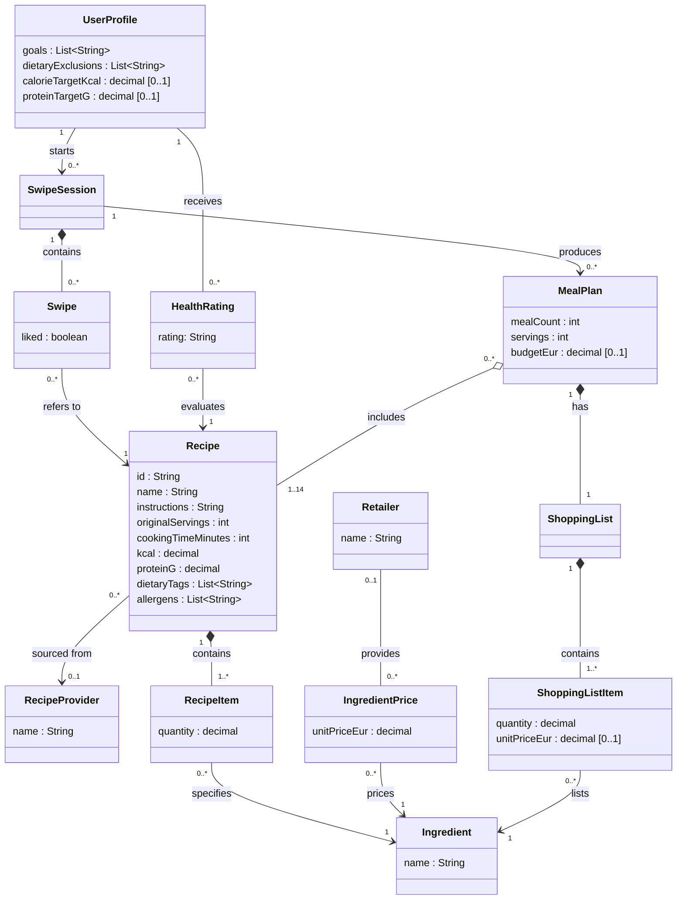

# Domain Model – MealSwipe

## UML Conceptual Class Diagram

## Domain Glossary

| Domain Concept | Definition |
|---|---|
| `UserProfile` | The user's goals, dietary exclusions, and optional default nutrition targets. |
| `SwipeSession` | A meal discovery session in which a user expresses preferences. |
| `Swipe` | A like or dislike for a recipe in a swipe session. |
| `Recipe` | A dish with ingredients, preparation instructions, and nutritional information. |
| `RecipeProvider` | A source that supplies recipe content, such as a recipe platform. |
| `RecipeItem` | The quantity of an ingredient specified in a particular recipe. |
| `Ingredient` | A food item that can be referenced by recipes, prices, and shopping lists. |
| `Retailer` | A grocery seller associated with ingredient prices. |
| `IngredientPrice` | A catalog price in EUR per standard unit of an ingredient, optionally attributed to a retailer. |
| `HealthRating` | An evaluation of a recipe's calories and protein against the user's active targets, with an explanation. |
| `MealPlan` | A selection of liked, eligible recipes for the requested number of meals. |
| `ShoppingList` | The combined ingredient requirements for a meal plan. Its estimated total cost is calculated from the list items. |
| `ShoppingListItem` | A combined quantity for an ingredient, with the unit price used for the estimate when available. |

## Domain Constraints

- Recipes must comply with the user's hard dietary filters.
- A meal plan consists of recipes liked by the user.
- A meal plan contains the requested number of meals (X).
- Meal selection considers price, cooking time, and personal goals.
- Health ratings depend on the recipe and the user's goals.
- Quantities use grams for weight, millilitres for volume, and pieces for counts. For example, 1.25 kg is represented as `quantity = 1250`.
- The shopping list combines quantities of the same ingredient expressed in the same standard unit.
- The estimated shopping-list total uses each item's quantity and a catalog price in EUR per the same unit. A complete estimate requires a price for every item.
- Previous meal selections are considered to support variety.
