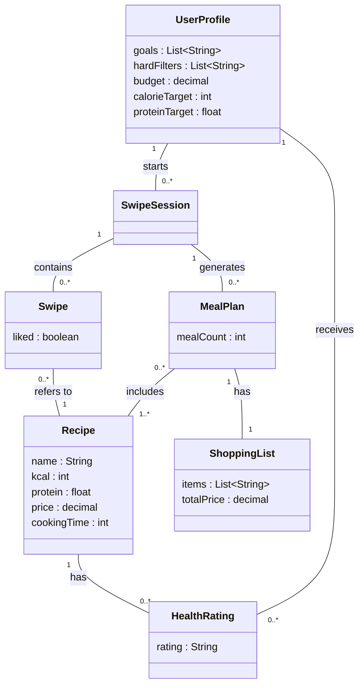

# Domain Model – MealSwipe

## UML Conceptual Class Diagram

## Domain Glossary

| Domain Concept | Definition |
|---|---|
| UserProfile | Represents the user's personal goals, dietary filters, budget, and nutritional targets. |
| SwipeSession | A session in which the user expresses preferences for recipes. |
| Swipe | A user's decision to like or dislike a recipe. |
| Recipe | A dish with nutritional information, price, and cooking time. |
| HealthRating | An evaluation of a recipe relative to the user's personal goals. |
| MealPlan | A selection of liked recipes based on price, cooking time, and personal goals. |
| ShoppingList | An aggregated list of items required for a meal plan, including pricing information. |

## Domain Constraints

- Recipes must comply with the user's hard dietary filters.
- A meal plan consists of recipes liked by the user.
- A meal plan contains the requested number of meals (X).
- Meal selection considers price, cooking time, and personal goals.
- Health ratings depend on the recipe and the user's goals.
- The shopping list is aggregated from the selected recipes.
- Previous meal selections are considered to support variety.
